### Location: 50.133105454306566, 11.00099427975901
<!-- 06.11.2026 - 08.11.2026 -->

## 6 November 2026 – Day 1

This was going to be another multi-day trip, and hopefully a better one than the last. The GO! Meetup was bringing together students from four universities: Coburg, Bamberg, Hof and Bayreuth. There were workshops, group activities, discussions and, apparently, plenty of opportunities to meet new people.

I decided to write this post in real time, so some of the entries have timestamps and were written as things happened. The rest were added whenever I found a little time. This is probably going to be a long one, so let's begin.

I woke up at around 4 AM for several reasons. Firstly, I had gone to bed before 23:00 the previous night. Secondly, I had slept for almost 11.5 hours the day before. And finally, I had left the heater running at maximum, which meant my room had become uncomfortably hot.

After washing my face, I sat there contemplating what to do. I had originally planned to have breakfast at 9, but since I was already awake, I needed something to eat. I had two options: bread and butter with tea, or coffee with mathri. I went with the first option.

After breakfast, I completed the introductory video I was supposed to watch for the programme. I then packed my bags and got ready.

At around 9:30, I got up for breakfast again. Initially, I had planned to make my version of fried rice, especially since I had bought a kilogram of bell peppers. But yesterday, I had changed my mind and decided to cook pasta instead, with enough leftovers to last until Sunday.

Unfortunately, after boiling the pasta, I was already too tired to do anything more complicated. So I decided to either cook it the next day or simply eat it with pesto. I chose the latter, adding some spices and cheese. Thanks, Soulfood Tuesday, for the dish! The pasta was supposed to last two or three meals. I ended up eating almost 80% of it. My stomach became so full that I had to take a disene. (By the way, it is still hurting at 12:09 when I am  writing this.)
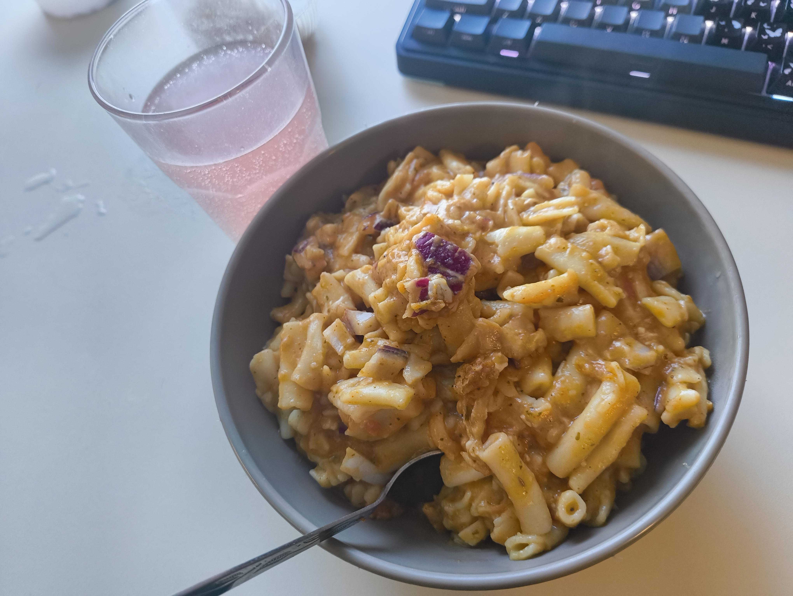

After that, I packed my bag, got dressed and was finally ready to leave. I even came back once more to check whether I had turned off the stove. Better safe than sorry!

### The journey to Kloster Banz

When I reached the Bahnhof, an RB24 operated by Agilis was already waiting. Before planning this trip, I had considered buying a student ticket. However, I decided to ask the student representative whether my student ID would be valid for the journey. He confirmed that it was valid on all DB Regio and Agilis trains along the Sonneberg–Bamberg route.

That was great news, as it meant I would only need to pay for the bus from Bad Staffelstein to Kloster Banz, which was considerably cheaper than buying a separate DB ticket.

There was one small condition, though. I couldn't take Agilis-operated trains beyond Lichtenfels. I initially thought the RB trains were operated by DB, so I panicked a little. Thankfully, after checking, I discovered that RB24 was operated by Agilis, while RB25 was operated by DB. So I suppose I didn't need to buy an additional ticket after all.

**12:17 – Inside RB24:** The ticket inspector has just checked my student ID. The train is so small that I can practically see both ends of it. Hopefully, everything goes well in the the next train as well.

**12:40 – Bad Staffelstein Bahnhof, bus stop.**

While waiting at the bus stop, I noticed a guy carrying a very recognisable bag. For a second, I thought it was Pinto, but then I dismissed the possibility. Surely not.

Then I saw him from the front.

It was Pinto!

He was also here for the GO! programme, and it felt genuinely nice to meet him after so long. We caught up on life, internships,  classmates and a bunch of other things while waiting for the bus.

Unfortunately, the bus that was supposed to take us to Kloster Banz never arrived. The organisers had arranged cabs for the GO! participants, but there were apparently only two of them running back and forth. Since Pinto and I were busy chatting, we ended up being among the last people to reach the venue.

### First impressions and new faces

From the outside, Kloster Banz looked quite pretty. From the inside, however, it was enormous. Almost Hogwarts-like!

Pinto got room 121, while I was assigned room 809. I got separated while trying to find Pinto's room, so I  went to mine to drop off my luggage. I then tried to locate his room, but even after asking the receptionist for directions, I couldn't find it.

Eventually, I met a very nice cleaning lady who actually walked me halfway there. Pinto's room was two or three floors underground, and there was absolutely no mobile network or Wi-Fi down there.

We eventually came upstairs and settled in the common room. That's where we met Nagini. She was from the University of Bayreuth (I initially thought she was from Bamberg) and was studying Food Science.

We chatted for a bit and then got ready to leave for the conference. On our way, Nagini stopped at reception to ask whether she had been assigned a roomate. I asked the same question, as my room had three beds and one was still empty. We asked whether she could move Pinto into the spare bed in my room, and she kindly agreed.

We also met Lindsay, who was from Coburg and studying autonomous driving.

At around 14:50, we entered the conference room.

People were sitting in groups of four. Pinto found a place somewhere, and I was initially planning to sit alone. However, I noticed a guy sitting by himself, so I decided to join him. His name was Eugene. He was German and had served in the army for 13 years. He was also incredibly fit! He was now studying for a bachelor's degree in textiles. We chatted a little before the programme began.

The event started with introductions from the four participating universities: Coburg, Bamberg, Hof and Bayreuth. There were coaches, administrators and people in several other roles, and everyone introduced themselves. We then had a brief introduction to the programme.

One small problem: most of it was in German, so I had to rely on Google Translate to understand what was happening.

### The first activity

We then played a small introductory game, which turned out to be much more fun than I expected.

There was an inner circle and an outer circle of people. A question appeared on the screen, and when the first bell rang, the person in the outer circle had to answer it. After a minute, another bell rang, and the person in the inner circle had to answer the same question.
Then the bell rang again, and everyone in the outer circle moved one place to the left, changing their conversation partner. A new question appeared, and the process repeated.
We didn't even manage to complete a full circle, or perhaps not even half a circle, but I got to speak to six or seven different people. It was surprisingly fun and a great way to start talking to strangers without the usual awkward introductions.

At around 16:05, we had a tea break. I took some Darjeeling tea and chatted with Lucas for a while. I then noticed Nandani sitting alone, so I joined her. Pinto came along a minute later, and the three of us shared the protein bar I had brought. None of us got much of it, but at least we shared!

Soon, the seminar resumed.

This time, Nico, a coach from Bayreuth, was telling us his life story, followed by a question-and-answer session. I was getting hungry and sleepy, and since the conversation was in German, I was struggling to follow it even with Google Translate. I eventually gave up and concentrated on eating my snacks. I had initially thought dinner would be served at 18:00, but then I found out it wouldn't be until 19:00. So I went back to my room to grab something to eat before returning.

When I came back, the participants from each university were already sitting together, discussing something. There were also cookies on the table, and I immediately helped myself to whatever was left before asking what was going on.

Apparently, each university was supposed to conduct a creative workshop hosted by its students, and we had to come up with an idea. Our group eventually settled on a hackathon. Quite unique!

### Dinner, conversations and bowling

Finally, it was dinner time.

Pinto was busy discussing something with Nico, while Niyati had gone back to her room for a moment. Since there were still around ten minutes before the food was served, I found myself alone.
Pinto eventually returned, and he, Lindsay and I joined a long table with some students from Hof.
Before the food arrived, Lindsay asked me to take some pictures of her. So that became one of my unofficial responsibilities for the evening.

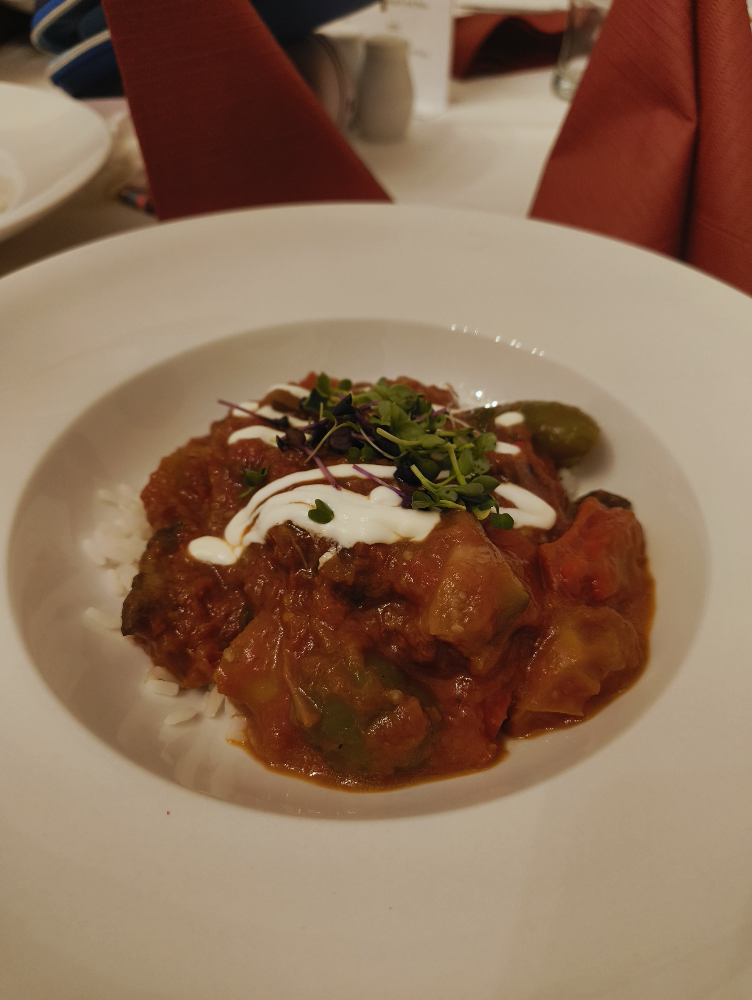
For dinner, I got a vegetable dish with rice. Unfortunately, the portion was rather small, and I was so hungry that I finished it very quickly. During dinner, Lindsay told me about her health issues, including an autoimmune disease, and some of the difficulties she had experienced because of it.
Everyone else at the table seemed to be eating beef. I asked whether I could get another serving, but they refused. Actually, Lindsay was the one who asked on my behalf!

There was no dessert either, which was another disappointment.

I was getting a little bored waiting for Lindsay to finish her dinner, so I decided to get up and go for a walk. Just behind me, Niyati and her friend had arrived and were waiting for their food. They had been given a different vegetarian dish because they didn't eat beef. Niyati's friend didn't particularly like it and offered it to me.

Obviously, I accepted.

We chatted for a bit about India and Turkey. Pinto tried to hit on a pretty girl and eventually we went outside for a smoke. Pinto stayed behind to talk to her.

Outside, I met a Pakistani guy from Islamabad. He was pretty cool, and we talked about life, family and Punjabi culture. Namrita, by the way, is from Nainital and is Punjabi. She is quite proud of that! I also took quite a few more pictures of Lindsay before we headed inside for bowling.

The bowling setup was interesting. They had small bowling balls, some with two holes and some without any holes at all. Drinks were free, so I got myself an Apfelsaft (apple juice).

There was also a table-tennis table, which was fun. Pinto and Namrita were busy making dirty jokes all night, something I didn't particularly want to participate in. I took a lot of  pictures and videos of Lindsay, played a few rounds of bowling myself and enbjoyed the atmosphere before deciding to head to my room at around 21:30.

It took me a while to find my room. On the way, I came across a guy who seemed to have lost his way, so I helped him find his room too.

**22:06 – Back in my room.**

I've changed my clothes, brushed my teeth and am finally in bed.

Goodnight!

---

## 7 November 2026 – Day 2

`I was supposed to write this entire post in real time, but things got a little busy. So I'm writing this at 4 AM on 11 November, based on whatever I can remember.`

I opened my eyes a little before 5 AM, then went back to sleep. I woke up again at 6 and wondered why on earth I needed to wake up so early. Naturally, I went back to sleep again. I finally tried getting up at 7. By this point, Pinto was already awake and exercising shirtless. Quite a productive start to the morning, I'd say.

I took a shower, then Pinto did the same, and we headed for breakfast at around 8. We were among the first people there.

I picked up some fruits while Pinto started with cereal and milk. I then went to get bread and jam, but by the time I returned, someone else had taken my seat. Thankfully, Navaya had arrived by then, so I sat with her.

I had bread with jam and butter, followed by scrambled eggs.

### A day of workshops (and a little bit of everything else)

We headed to the session at around 9.

Pinto, Nena, a German girl and I sat together. The first activity involved filling out a skills card. I'm still not entirely sure what its purpose was, but we did it anyway.

Then, we were then randomly divided into groups of three and asked to introduce ourselves for a minute. After that, we had to write two skills we already possessed on yellow notes and two skills we wanted to learn on pink notes, then stick them on dedicated boards.

For my yellow notes, I wrote sensor technology. For the pink ones, I added 3D printing and communication skills. I couldn't think of another skill I possessed. Apparently, recognising your own skills is harder than it sounds.

We were then divided into two groups: people who already knew what they wanted to work on and people who didn't.

Pinto and Nena went to the first group, while I stayed with the second. The German girl was already at the table with me, and another girl from Africa joined us at a table.

We initially spent some time answering a few personal questions to get to know one another. Afterwards, we selected topics that interested us based on those answers and formed groups around them.

    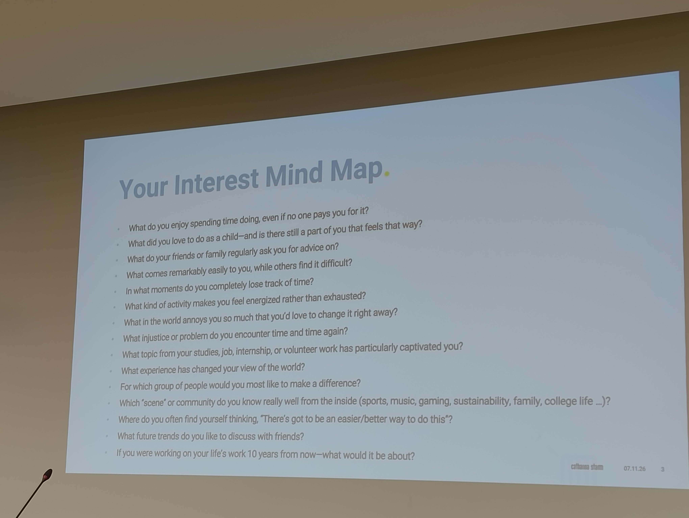
    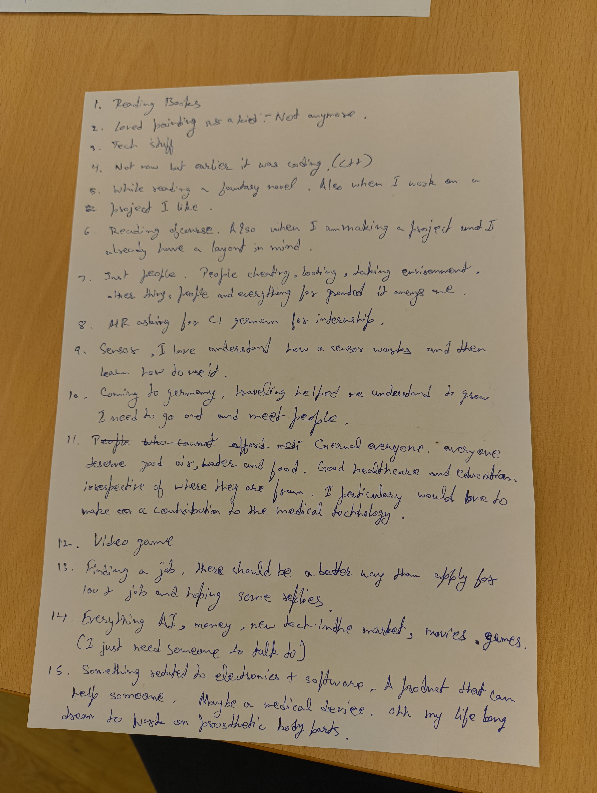

I ended up in the *Future of Work* group.

Now we had to come up with project ideas.

After a little while, we had a short tea break, where I met Nena and the others again. Pinto wasn't around at that point. We soon returned to work.

Our Future of Work group came up with an idea to help optimise company operations. There was one guy in the group who sounded particularly intelligent, and he and another participant decided to work together on a different idea. I joined them. Their idea was to collect people's passport information and sell it. There were quite a few flaws in that idea, to put it mildly.

Eventually, everyone presented their ideas. The guy in my team simply wrote something on a piece of paper and presented it. At least I managed to eat some sweets during the session!

After that, we went for Mittagessen. I had vegetables with Thai sauce, and the sauce was absolutely delicious.

### Building ideas together

We were back around 14:30.

This time, we were together again: me, Pinto, Nisha and the German girl.

Every time Pinto spoke to the German girl, Nisha would tease him with a simple "Nahi degi". (She won't give you a chance.)

And so the day continued.

We started another activity, which had several steps.

**Step 1:** Draw something you would like to work with or something related to your project.
I drew a robot. Nisha drew an ice cream, Pinto drew a little dinosaur robot, and the German girl drew something related to community work.

**Step 2:** Pass your paper to the person on your right. They had to write six points about what they thought of your drawing.

I received Nisha's paper, while she got something that nobody could quite understand. It involved a magnifying glass, I think.

**Step 3:** Pass that paper to another table, where the participants had to write three questions about the drawing.

**Step 4:** Come up with the name of your project in six words, bot a word less and not a word more.

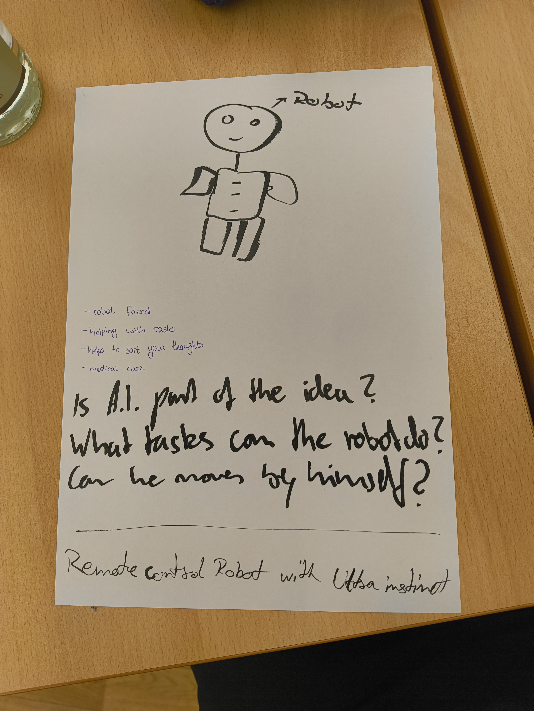
That was  fun int its own way.

Once everyone had finished, we were asked to present our projects and stick our sheets on the wall. For some reason, nobody from our table presented anything. We were then given sticky notes and asked to walk around, find projects that interested us, write our names underneath them and leave a question for the people who had come up with the idea.

### A walk through the forest

After the activities, we went outside for a group photo and then headed out for a walk in the forest.

Initially, I was walking with a group consisting of Pinto, Nidhi, Talha and a guy from Bamberg. However, they eventually started talking in pairs, and I found myself being the odd one out. So I walked ahead.

I tried joining some other groups along the way, but that didn't really work either.

Then I met Utkarsh, who was also walking alone. Now, this was interesting because the previous night, he had been dressed in what I would describe as rapper clothes, with his cap turned sideways. He looked quite casual, almost unprofessional. Today, however, he was wearing a shirt and looked extremely professional.

I don't know. I don't really understand fashion.

Anyway, we started talking. He is also from Hochschule Coburg's but from Kronach campus, studying autonomous driving, and originally from Andhra Pradesh.

After talking for a while, I decided to look for Nidhi and Pinto. I eventually spotted Pinto walking with the German girl, but Nidhi was nowhere to be seen. I joined them for a little while, but then stayed slightly behind to give them some space.

After some time, we were told to turn around and return the same way because the path we had taken didn't actually lead anywhere.

By the way, Nico was also there, wearing a trench coat. Pinto admired how good he looked in it.

I was walking behind Pinto and the German girl, lost in my own thoughts. At some point, they started discussing Indian stereotypes. The German girl had apparently heard a few things, and Pinto was trying to explain and correct them. Utkarsh joined the conversation out of nowhere at somepoint which i found out later from Pinto as at that time  I wasn't paying much attention to them.

We eventually stopped just before reaching Kloster Banz, where the four of us took a selfie.

  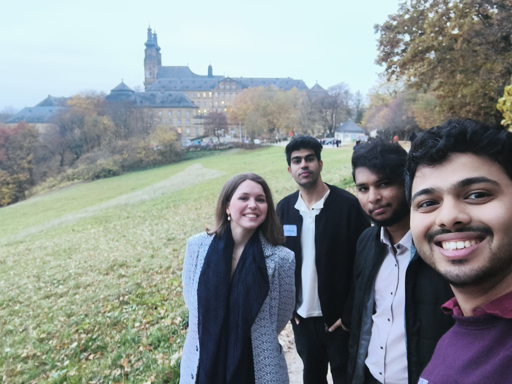

Utkarsh then started explaining something about cows to the German girl. I decided it was time for me to intervene. I said something along these lines:
"I'm a Hindu, and we believe cows are holy, so I should probably answer this. We consider cows to be like our mothers because they are docile animals that stay with us and provide us with milk while asking for very little in return.
There is also the issue of cows roaming around on Indian roads. As we cut down forests to build cities, there is less natural space for them. At the same time, there are still cowherds/ milkmen who keep cows in cities to provide fresh milk every day. But because they live in the city, the cows don't have enough grass or open spaces to graze. Due to neglect by their owners, some are eventually left to eat garbage on the streets."

I explained a little more, but that was the general idea.

Afterwards, I took Utkarsh aside, leaving Pinto and the German girl together. We talked for a bit. The conversation eventually shifted towards India and its problems. I mentioned that every country has its pros and cons and that I particularly missed Blinkit in Germany. Utkarsh, however, felt that the cons of India were far too many. I responded with something along the lines of:
"Well, why wouldn't they be? People like us leave the country as soon as we become capable of doing something for it."

He then started telling me about all the voluntary work he had done, at which point i was like ok i get it you are a good guy, you don't need to prove me anything.

We eventually met Neelam and another girl taking pictures near the entrance of Kloster Banz. We all took another group photo and went inside.
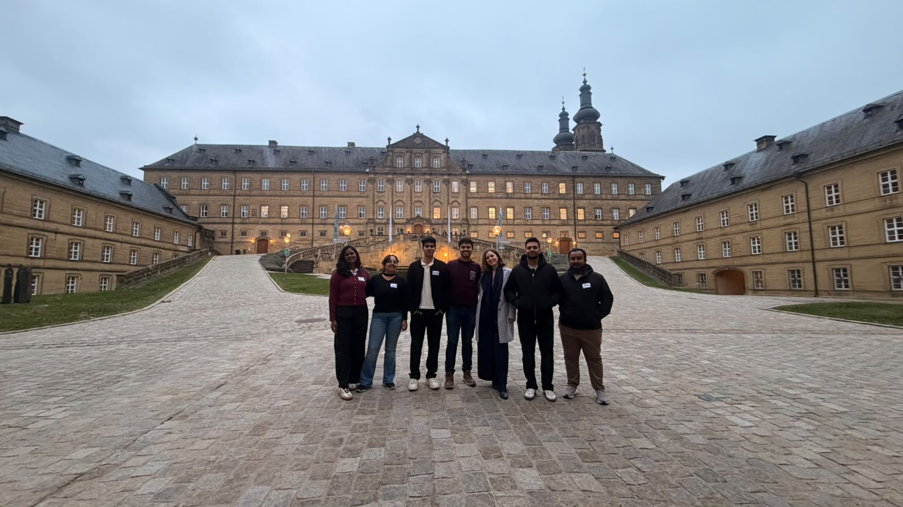

It was around 16:45, and time for the tea break.

### Project pitches, dinner and a long evening

After the tea break, all the project ideas were put up on the walls, and we were asked to choose the ones we liked.

I liked Nisha's idea, although I couldn't really see how I could contribute to it.

I also liked Utkarsh's idea, called **Reckoning**. It was essentially a personalised AI tool to help people make decisions. He seemed quite enthusiastic about it, although I don't think he had fully figured out what he wanted to do with it yet. He was still shooting arrows into the air, so to speak.

Then there was Pinto's idea, which was actually brilliant. However, he was essentially pitching his boss's idea. He didn't really have to work on developing anything himself; he was there mainly to help get funding for it.

I was just hanging around with Pinto when Mahmoud approached us. We started talking, and we ended up having quite a long conversation. He then told me about his idea, which I found genuinely interesting. So interesting, in fact, that we kept talking until it was practically dinner time. Before leaving, I told him that I would join his group.

There was still a little time before dinner, so Pinto and I went back to our room. Pinto went to the washroom, while Talha was sitting there scrolling through Reels.

I had a migraine coming on, so I took a naproxen tablet and slept for about five minutes.

Then we went for dinner.

Nisha had kindly saved two seats for us. Today's meal was a steak made of kohlrabi, which was actually quite good.
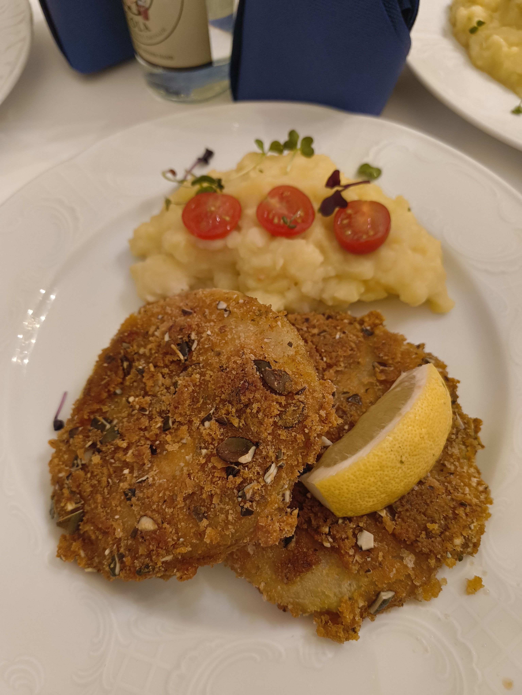

After dinner, we headed outside and walked around for a bit.

At 19:30, there was supposed to be a session where participants from last year's GO! programme would share their experiences. Nobody seemed particularly interested in attending, but I suggested that we at least go for a while and then head home.

So we went inside at around 19:45–19:50, by which time the event had already started. There were drinks and snacks. Unfortunately, most of the soft drinks were gone, so Nisha picked a non-alcoholic Radler for me. It was my first time trying one, and I can confidently say that it tasted worse than piss.

We sat at our usual table. Nisha was on my left, I was at the bottom side of the table, and on the rigt side sat the German girl followed by Pinto. I spent most of the session eating snacks and occasionally falling asleep. Everyone was speaking German, and I simply didn't have the energy to read translation on my phone.

Talha and the guy from Bamberg left around 20:30. Neha also wanted to leave, but I stopped her.

Let's suffer together.

The session finally ended around 21:30, and we headed out.

I left Pinto with the German girl. There was also a guy from Bihar who was trying to join their conversation. I decided to take  him with me towards the entrance gate so Pinto could have some alone time with the German girl. Pinto later told me that the guy had come back (sad).

I headed towards my room. I think Nalini, Talha and the Bamberg guy had gone out for a smoke because I received a message from Nalini:
"Where are you?"
I replied, "Room? Why?"
She responded, "Cool."

I changed my clothes, brushed my teeth and got into bed. By then, Pinto, Talha and the Bamberg guy had arrived. Pinto was planning to go to the sauna, so I decided to tag along.

### The sauna experience

At the door, we met Nanami, and we practically dragged her along with us.

Thankfully, the sauna was open until 23:00. It was already 22:13, but we decided it was still worth going. Nanami headed home.

While changing, Pinto asked me again:
"Bro, you know you gotta be fully naked?"
I was like, "Yeah, what's the issue?"

So I took off all my clothes and kept only a towel around my waist. I then took a shower, completely naked, and there was already a woman in the shower area, and i instintively said hello. After that, Pinto and I entered the sauna.

There were already several men and women inside, all completely naked. I still preferred to keep my towel around my waist, though.
We sat down and started talking. This was Pinto's first time trying a German sauna, and his first time being completely naked in one. He was glad he had finally tried it.

After some time, the German girl Pinto had been talking to all day also arrived. She came in and sat next to us. I was initially sitting between Pinto and her, but I got up to turn the hourglass and then moved to a seat adjecent from them.
I had a feeling she might not have enjoyed the sauna experience completely, as it was probably a little awkward being there with the two of us.

Pinto then started telling us a story about his second day in China, when he had technically been kidnapped. There was another woman in the sauna who seemed to enjoy the story as well.

At some point, the German girl wanted to try the steam sauna. I urged Pinto to follow her, while I decided to stay back and complete my 30 minutes.

Just after I finished my 30 minutes inside, a girl said something in German. The woman sitting next to me explained that we had to leave because the guard would throw us out in five minutes.

So I got up and went outside.

Pinto was talking to an elderly gentleman about India. I sat down for five minutes to cool off, then took a shower and headed to the changing room.

When we returned to our room, Nupur, Talha and the guy from Bamberg were already there, talking. We joined them, ate some snacks and discussed all kinds of random things. We also exchanged a few ghost stories. And, at some point, we discovered that Nupur's boyfriend apparently looked like Utkarsh, just with a better haircut.

Throughout all this, Pinto was still chatting with the German girl. At around 00:30, she called him to her room.

By 01:00, I had gone to bed. The others went out for a smoke.

And that was Day 2. Quite a day, considering I had started it with absolutely no intention of doing much more than attending a few workshops.

---

## 8 November 2026 – Day 3

The final day.

I woke up at around 05:50. I was still lying in bed, considering whether I should go back to sleep, but eventually decided against it. This was the last day, after all. I finally got out of bed at 06:10.

Pinto was also getting up, so I asked him whether he wanted to go to the sauna. He agreed.

I freshened up while Pinto did a little exercise. While he showered, I ate a protein bar along with some peanuts and biscuits.

By 06:45, we were at the sauna. Unfortunately, the regular stone sauna wasn't hot, so we tried the steam sauna instead. That worked for a little while, until it didn't.

We eventually came out at around 07:18 and met an elderly gentleman who informed us that, since it was Sunday, the sauna wouldn't open until 08:30.

So, essentially, I had ruined my sleep for nothing.

We were heading towards the changing rooms, disappointed. Pinto really wanted to use the swimming pool, but neither of us had brought swimming costumes. However, there was already a man swimming in the pool. I suggested that Pinto ask him whether swimming in our boxers would be acceptable. If he said yes, we could go in.

I put on my boxers, but Pinto had a different approach. He simply took his underwear in his hand, showed it to the man and asked whether it would be okay to swim in them.

The man said it was completely fine and told us to jump in.

And so we did!

The pool wasn't particularly deep. If I stood straight, the water barely reached my nipples.

I had learnt swimming as a child and used to visit swimming pools quite frequently. However, I think not having much muscle and spending most of my time sitting in chairs has ruined both my muscle memory and my posture.

Even floating on my back was surprisingly difficult.

Still, I tried to swim as much as I could. I sank a few times, struggled a little and mostly just played around in the water.

At around 07:50, I urged Pinto to leave because we had to check out by 09:00, and breakfast was also available only until 09:00. We showered, got dressed and returned to our room.

I was the first to take a shower, so I started packing while Pinto got ready. Initially, he told me to leave without him, but I decided to wait.

We finally left the room at 08:34 with our bags.

### The last breakfast and the final session

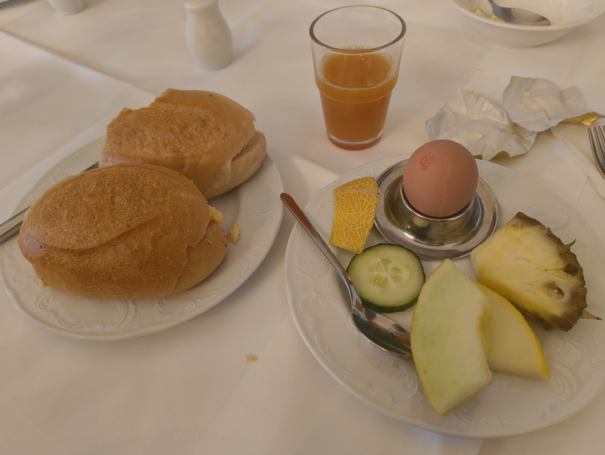
Breakfast was pretty much the same as the previous days. This time, however, I skipped the bread and jam. Instead, I made myself a scrambled egg and butter sandwich. I also tried a boiled egg, which was okay.

We headed to the seminar room at around 09:15 after returning our room keys.

For the final day, we were supposed to work with the groups we had chosen for our projects. I sat with Mahmoud and Mustafa. Mahmoud was 32, while Mustafa was just 18 and pursuing a bachelor's degree in electronics.

Our first activity was to build a tower using ten sheets of paper.
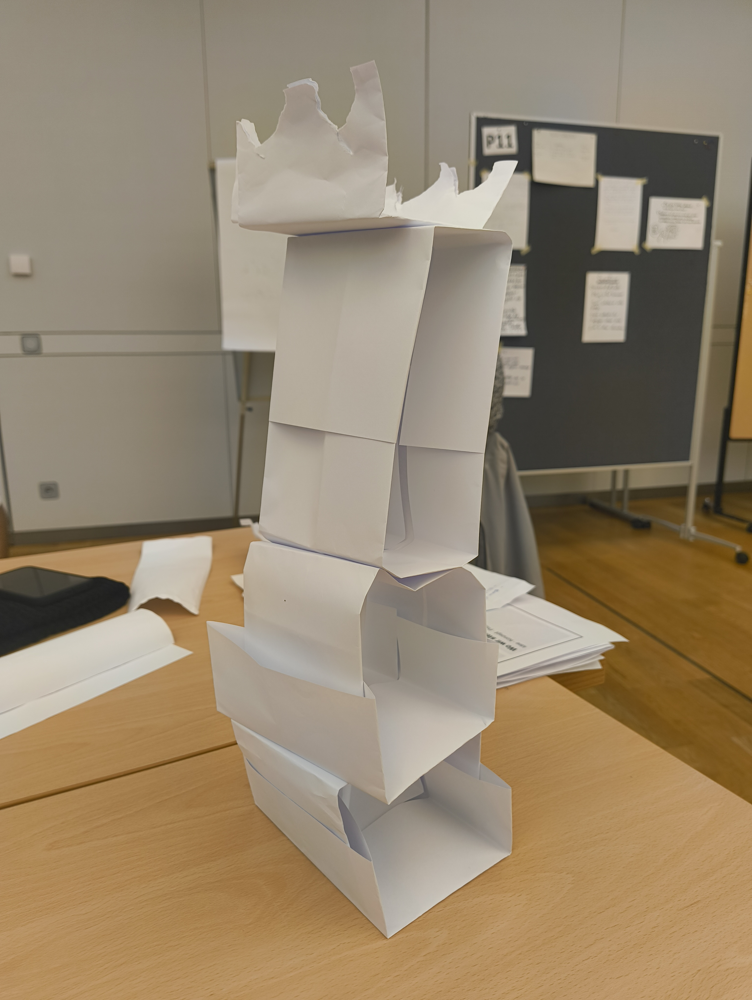
Ours wasn't particularly tall, but it had a very strong base. In fact, it was the only tower that remained standing until the end of the day.

After that, we started discussing our project in more detail.

When one of the coaches came over, I realised there was a problem with my involvement. The project was primarily about app development and database systems, and honestly, I didn't want to go back to that kind of work.

I had spent enough time dealing with those things already. We agreed that we would figure something out.

At around 11:30, we had another tea break. After that, we sat with the other participants from our respective universities. Everyone was speaking German again, and things were starting to get a little boring.

The gang decided to go to Bamberg to chill for a while, but I decided not to join them. Mahmoud, however, had an extra seat in his car, so I wouldn't even have to take the train back. That was convenient.

### Lunch and goodbyes

At around 12:30, we went for lunch.
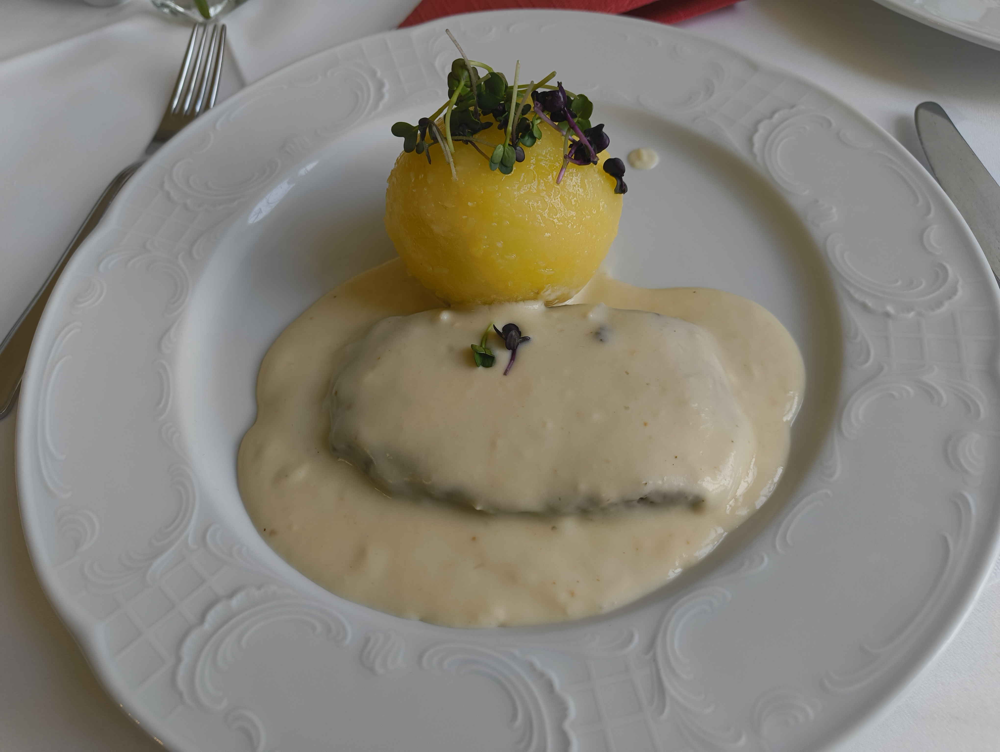
Today's meal was a beetroot steak. Neha had already taken the others out early, and they had decided to eat somewhere down the hill.

I said my goodbyes to everyone and stayed back to eat with Mahmoud, Mustafa and Utkarsh.

During lunch, Utkarsh started telling them about India's caste system. He spoke about how there are people who are considered untouchable, people who are not supposed to come near certain others, and even how some people have their caste written on their cars.

I just closed my ears. Some conversations are better left alone, especially when you're trying to enjoy lunch.

The steak was okay. The sauce was better than okay, but whatever potato thing was served alongside it was definitely not okay.

Anyway, I finished eating and went outside, where I met Mahmoud again. We chatted for a little while. 

By around 13:30, we were back inside. There wasn't much left to do. Each university had to host  other university students on the activity they had decided on in the morning. Now, we just had to explain what we were doing in a two-minute presentation.

By 14:15, the entire programme had officially ended.

Mahmoud had some family to meet, and his original plan was to drop us off in Coburg before returning. I told him he was crazy if he thought he needed to do all that. Just dropping me at the Bahnhof would be more than enough. He ended up dropping me at Lichtenfels, from where I could take a direct train.

Kese was also with me during the journey. He was learning French on Duolingo and had a streak of more than 2,000 days, which was absolutely crazy.

And just like that, the three-day meetup was over.

### Back home – and an unexpected Diwali evening

I reached home, dropped my bags in my room and went to Utkarsh's room (our Utkarsh from FMS) to borrow the vacuum cleaner. My carpet was terribly dirty, and I had finally decided to do something about it.

Unfortunately, Prince had already borrowed the vacuum cleaner.

I barely made it back to my room when Pinto messaged me:
"Where are you?"

Apparently, he was already at Coburg Bahnhof. I still don't know how he managed to get there so quickly.

I changed my clothes while on a call with Mummy, Bhai, Naimta Chachi and Hanu. Somewhere during all this, I completely forgot that it was Diwali.

Before I could unpack or even attempt to tidy my room, Pinto arrived.
He then decided to go for a walk while I stayed back scrolling through Reels. When he returned, I don't know when exactly, but I had fallen asleep. It took me a minute to wake up properly and open the gate.

We started discussing what to make for dinner. Just then, Pinto received a message from the German girl.

Apparently, he had a date that evening. I asked him to bring me a pizza as well.

While he was away, I went back to scrolling through Reels, played a little Payday 3 and eventually fell asleep again.

I woke up sometime after 22:00.

Pinto still hadn't returned, so I messaged him to ask whether he was bringing the pizza or not. He didn't reply for about ten minutes, and I was getting extremely hungry. So I decided to make myself some tea and bread with butter.

I was halfway through dinner when he finally messaged: "I'll be there soon. Don't eat anything." Unfortunately, I didn't see the message because I was already eating.

By the time I finished, Pinto arrived with a Margherita pizza, looking all happy and lovey-dovey.

He then went to Manish's place for a bit, leaving the pizza behind. I looked at the pizza and thought, why not? So I ate the whole thing.

It was really cold, and I sat there eating it while feeling sorry for myself. But honestly, food is food, and I wasn't going to waste it. It took me a little while to finish the entire pizza. By the time I was done, Pinto had returned.

We sat together for a bit and then decided to sleep.

We talked about the programme, the German girl and how much he seemed to have in common with her. I also told him about Utkarsh's conversation about the caste system during lunch.

Eventually, we settled down for the night.

I ended the day with:
"Gute Nacht. Süße Träume."
